# wsike: IKEv2 client for Windscribe on Linux

<p align="center">
  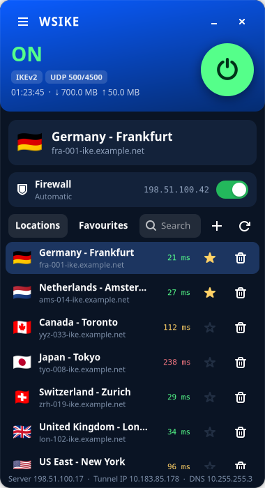
</p>

A desktop VPN client in the style of the Windscribe app, built for **IKEv2**,
which the official Linux client doesn't offer. Developed for Ubuntu (GTK4 + libadwaita,
strongSwan, nftables, systemd-resolved).

> Not affiliated with or endorsed by Windscribe. You need your own Windscribe
> account; wsike only uses the IKEv2 access Windscribe already gives its users.

## Why does this exist?

[Windscribe](https://windscribe.com) has an official desktop app for Linux:
**[windscribe.com/download](https://windscribe.com/download)**. It's polished, and if it
works for you, use it. It has features this project doesn't try to copy (R.O.B.E.R.T.,
static IPs, port forwarding, account management, and so on).

But the official Linux app doesn't offer **IKEv2**, even though Windscribe runs IKEv2
servers and hands out IKEv2 credentials in its
[config generator](https://windscribe.com/getconfig/ikev2). On a desktop that leaves
three options: configure strongSwan by hand, use NetworkManager's plugin (no kill switch,
easy to leak DNS), or go without. wsike adds what that setup was missing: a one-click
UI, a real kill switch and leak protection.

Why IKEv2 is worth having:

- **It runs in the kernel.** Linux's own IPsec (XFRM) does the encryption. No userspace
  tunnel process to crash, and it's light on battery.
- **It roams.** MOBIKE moves the tunnel when you switch between Wi-Fi, Ethernet or a
  phone hotspot, without reconnecting.
- **Another way through.** It uses UDP 500/4500 with standard IPsec. On networks that
  block or throttle the other protocols, IKEv2 sometimes still gets through, and the
  reverse is also true. Having one more option is the point.
- **It's simple to audit.** Plain strongSwan, `ip rule` and `nft` underneath; nothing
  proprietary.

## Screenshots

| Off | Connecting | On |
|:---:|:---:|:---:|
| 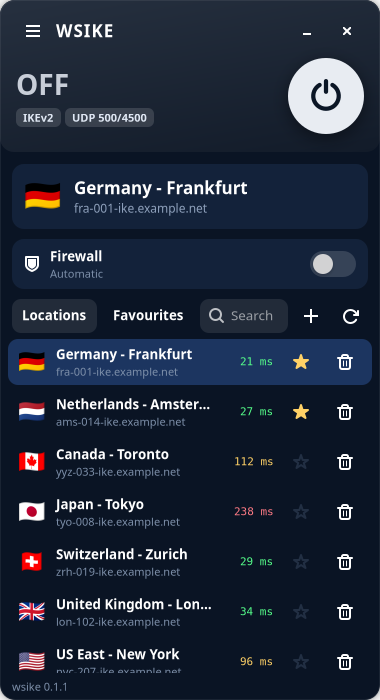 | 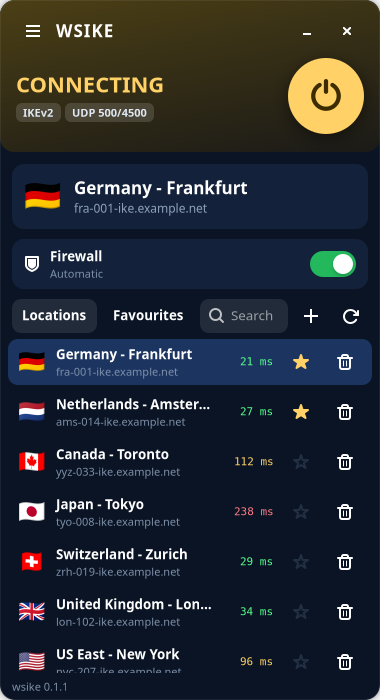 |  |
| Disconnected. The firewall follows its mode (here *Automatic*, so it's off). | IKEv2 handshake in progress. The kill switch is already up. | Tunnel up: session time, traffic counters, the public IP you appear with, server / tunnel IP / DNS in the footer. |

| Reconnecting | Connection lost, firewall holding | Favourites |
|:---:|:---:|:---:|
| 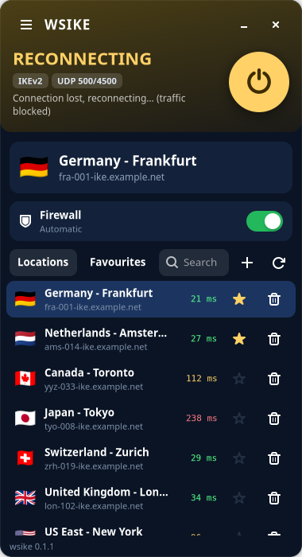 | 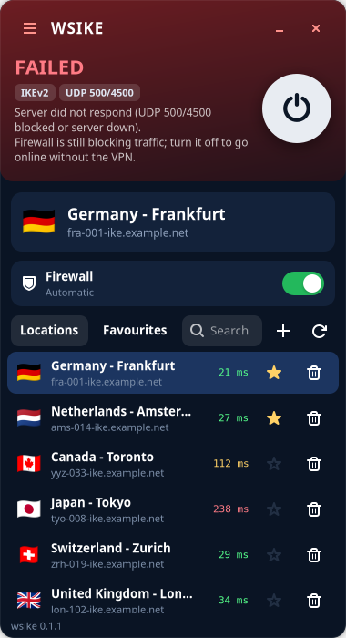 | 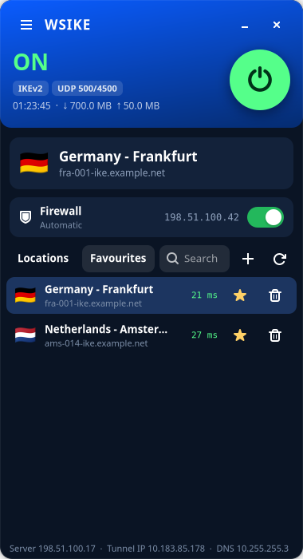 |
| The tunnel dropped and wsike is bringing it back. Traffic stays blocked meanwhile, so nothing leaks. | Reconnecting failed. The firewall **stays on** until you disconnect or switch it off. | Star locations to keep them on top and in the Favourites tab. Latency colours: green < 80 ms, yellow < 180 ms, red above. |

| Preferences: connection | Preferences: split tunneling |
|:---:|:---:|
| 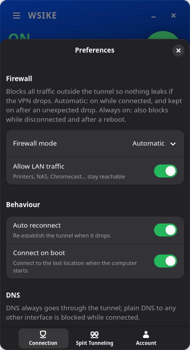 | 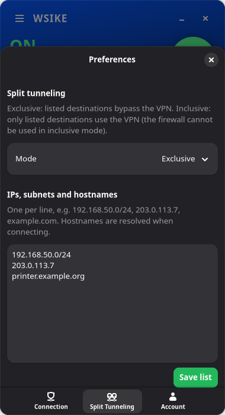 |
| Firewall mode, LAN access, auto-reconnect, connect on boot, custom DNS. | Exclusive or inclusive split tunneling by IP, subnet or hostname. |

<sub>Screenshots use demo data (made-up hostnames, documentation IP ranges). They're
generated by `tools/screenshots.py`.</sub>

## Features

- **One-click connect** with a Windscribe-style UI: big power button, ON/OFF header,
  location list with flags, favourites, search and latency.
- **Firewall (kill switch)**: all traffic that doesn't go through the tunnel is blocked.
  Modes:
  - *Manual*: the toggle stays where you put it.
  - *Automatic*: on while connected/reconnecting, off after you disconnect.
  - *Always on*: blocks even when disconnected and across reboots.
  In Automatic mode an *unexpected* drop keeps the firewall up until you disconnect
  or switch it off, so nothing leaks while you are away.
  Option: *Allow LAN traffic*.
- **No DNS leaks**: the VPN's DNS is set on `wsike0` with routing domain `~.` in
  systemd-resolved. While connected, plain DNS and DoT (53/853) to any other
  interface are rejected. The DNS server IPs are always routed into the tunnel.
- **No IPv6 leaks**: the tunnel is IPv4 only, so IPv6 is blocked while connected
  (and while the firewall is on), except LAN/neighbour discovery.
- **No IP leaks on drops**: the tunnel is route-based (XFRM interface `wsike0`).
  If the tunnel goes down, traffic is routed into a dead interface and, with the
  firewall on, rejected. Auto-reconnect brings the tunnel back.
- **Split tunneling** by IP, subnet or hostname:
  - *Exclusive*: listed destinations bypass the VPN.
  - *Inclusive*: only listed destinations use the VPN.
- Custom DNS, connect on boot, a debug log, and the `wsikectl` CLI.

## Install

```bash
sudo ./install.sh
```

The installer adds `charon-systemd`, `strongswan-swanctl`, the EAP plugins and the
GTK/libadwaita bindings. It also links the ISRG (Let's Encrypt) root certificates
into `/etc/swanctl/x509ca`. Windscribe servers send their own intermediate
certificates, so no downloads are needed. Finally it creates the `wsike` group,
gives the invoking user access, and enables `wsike-daemon.service`.

Options:

- `sudo ./install.sh --update` refreshes wsike's own files and restarts the daemon, without apt.
- `sudo ./install.sh --user NAME` grants access to another desktop user.

### Supported systems

- **Tested:** Ubuntu 26.10 (GNOME, NetworkManager, systemd-resolved). A clean
  install was also checked in a fresh `ubuntu:26.10` container.
- **Expected to work:** Ubuntu 24.04 or newer and Debian 13 or newer: any apt-based
  system with systemd, nftables, strongSwan 5.9 or newer and libadwaita 1.5 or newer.
  The installer checks these and stops with a clear message if something is missing.
- **Without systemd-resolved,** DNS is written to `/etc/resolv.conf` while connected
  and restored afterwards.
- **Conflicts:** the classic `strongswan-starter`/`ipsec` service and other IKE
  daemons use the same ports (UDP 500/4500). Running another VPN at the same time
  will also interfere with routing and DNS.

## Setup

1. Open <https://windscribe.com/getconfig/ikev2>, choose a location and generate the
   config. Note the **IKEv2 username, password and server hostname**. These are
   different from your Windscribe login.
2. Start **wsike VPN** from the app menu (or run `wsike`).
3. Go to ☰ → Preferences → Account and save the IKEv2 username and password.
4. Click **+**, paste the server hostname, and give it a name and country code.
   To add many servers at once, use ☰ → Import locations, one per line:
   `Name, hostname, cc`.
5. Click a location or the power button.

CLI equivalents:

```bash
wsikectl login
```

```bash
wsikectl connect <hostname> --wait
```

```bash
wsikectl set firewall_mode=always_on allow_lan=true
```

```bash
wsikectl logs
```

## How it works

<p align="center">
  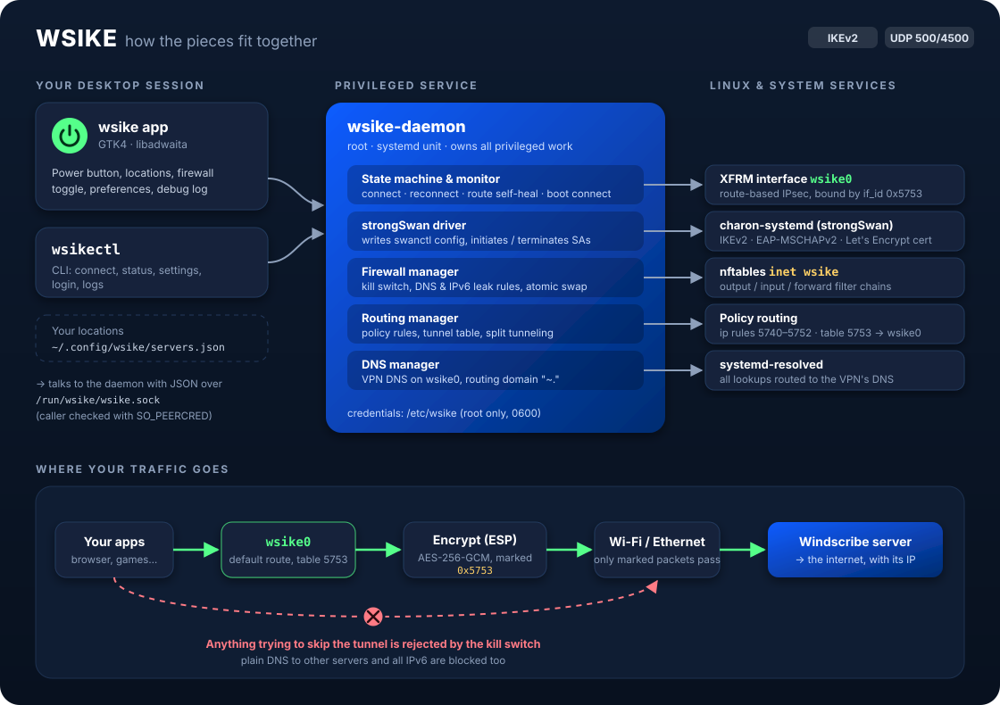
</p>

The app never needs root. It sends small JSON requests (`connect`, `status`,
`set_settings`…) to **wsike-daemon**, a root systemd service that does all the
privileged work. The daemon only accepts callers that are root, members of the
`wsike` group, or the user who installed it.

### Connecting

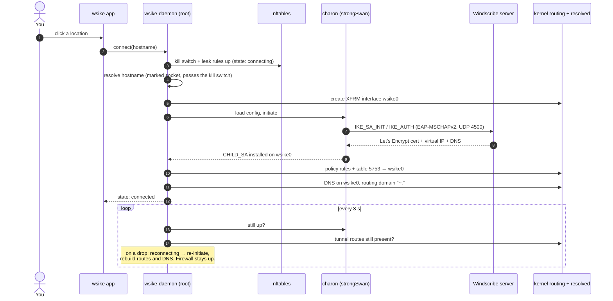

### Where a packet goes

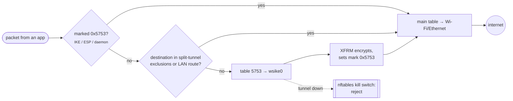

The routing works the way `wg-quick` does. IKE packets (charon's socket mark) and ESP
packets (`set_mark_out`) carry mark `0x5753`, so they always leave through the physical
interface and the firewall lets them through. Everything else is routed into `wsike0`.
This keeps working when you switch between Wi-Fi and Ethernet, and MOBIKE is enabled
too. If the tunnel goes away, unmarked traffic would fall through to the physical
interface, and that's exactly what the nftables `inet wsike` table rejects.

| Layer | What wsike configures |
|---|---|
| strongSwan | `/etc/swanctl/conf.d/wsike.conf` (generated, 0600): EAP-MSCHAPv2, `remote.id` = server hostname, `if_id` 0x5753, `set_mark_out` 0x5753, NAT-T forced |
| Interface | `ip link add wsike0 type xfrm if_id 0x5753`, MTU 1400, IPv6 disabled on it |
| Routing | rules 5740 (split exclusions) · 5745 (VPN server) · 5749 (DNS → tunnel) · 5750 (mark → main) · 5751 (main, no default) · 5752 (→ table 5753) |
| Firewall | one atomic `inet wsike` table: output/input/forward chains for kill switch, DNS (53/853) and IPv6 leak rules |
| DNS | `resolvectl dns/domain wsike0 … ~.`, or `/etc/resolv.conf` (backed up and restored) without systemd-resolved |

Files:
- `/etc/wsike/credentials.json`: IKEv2 credentials (root, mode 0600)
- `/etc/wsike/settings.json`: daemon settings
- `/etc/strongswan.d/wsike.conf`: charon-systemd settings (does not affect NetworkManager's charon-nm)
- `~/.config/wsike/servers.json`: your locations

## Development

Run without root, using a fake VPN backend:

```bash
WSIKE_SOCKET=$XDG_RUNTIME_DIR/wsike-mock.sock WSIKE_STATE_DIR=/tmp/wsike-state python3 bin/wsike-daemon --mock
```

```bash
WSIKE_SOCKET=$XDG_RUNTIME_DIR/wsike-mock.sock python3 bin/wsike
```

Regenerate the README screenshots (renders off-screen through GTK's Broadway backend;
each scene in its own process, with a browser open on `http://127.0.0.1:8089` so the
frame clock runs):

```bash
gtk4-broadwayd --port 8089 :9 &
```

```bash
for s in off connecting on reconnecting firewall-hold favourites preferences-connection preferences-split-tunneling; do GDK_BACKEND=broadway BROADWAY_DISPLAY=:9 python3 tools/screenshots.py docs/screenshots $s; done
```

Tests (nft rulesets are syntax-checked inside an unprivileged network namespace):

```bash
python3 -m unittest discover -s tests -v
```

## Limitations

- IPv4 only through the tunnel (IPv6 is blocked rather than tunnelled).
- Split tunneling works by destination (IP, subnet or hostname), not per application.
- No tray icon: GTK4 has no tray API. The VPN keeps running in the daemon when you close the window.
- Windscribe has no public IKEv2 server list API, so you add servers from the config generator.
- Uninstall with `sudo ./uninstall.sh`. Add `--purge` to also remove credentials and settings.
